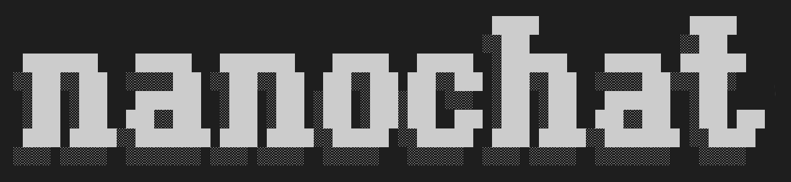
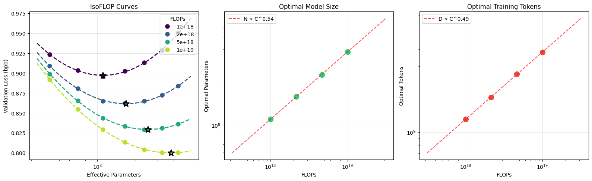

# nanochat




nanochat 是一套尽量简单的实验框架，用来训练大语言模型。它面向单台 GPU 机器，代码短、方便改，并覆盖分词、预训练、微调、评估和推理这些主要阶段。举个例子：2019 年训练一个 GPT-2 能力水平的模型大约要花 4.3 万美元；用 nanochat，在一台 8 卡 H100 上大约 2 小时、约 48 美元就能训出来，然后用一个简单的命令行和它对话。如果用竞价实例，总花费可以更接近 15 美元左右。

更一般地说，nanochat 开箱即可训练一整组计算最优的模型。你只需要拧一个复杂度旋钮：`--depth`，也就是 GPT Transformer 的层数（GPT-2 能力大约对应 depth 26）。宽度、头数、学习率、训练步数、权重衰减等其余超参数都会按较优方式自动算出来。

关于这个仓库的问题，作者建议使用 Devin/Cognition 的 [DeepWiki](https://deepwiki.com/karpathy/nanochat) 提问，或到上游的 [Discussions](https://github.com/karpathy/nanochat/discussions)，也可以去 Discord 的 [#nanochat](https://discord.com/channels/1020383067459821711/1427295580895314031) 频道。上游仓库是 [karpathy/nanochat](https://github.com/karpathy/nanochat)。

## 达到 GPT-2 水平的时间榜

目前开发的重点是预训练阶段，因为它最吃算力。受 modded-nanogpt 启发，也为了推动进展和协作，nanochat 维护一块「GPT-2 竞速」排行榜：在 8 卡 H100 上，把模型训到 GPT-2 水平（以 DCLM CORE 分数衡量）所需的墙上时钟时间。[runs/speedrun.sh](runs/speedrun.sh) 始终是训练 GPT-2 水平模型并与之对话的参考脚本。当前榜单如下：

| # | 时间（小时） | val_bpb | CORE | 说明 | 日期 | Commit | 贡献者 |
|---|-------------|---------|------|-------------|------|--------|--------------|
| 0 | 168 | - | 0.2565 | 原始 OpenAI GPT-2 检查点 | 2019 | - | OpenAI |
| 1 | 3.04 | 0.74833 | 0.2585 | d24 基线，略微过训 | 2026-01-29 | 348fbb3 | @karpathy |
| 2 | 2.91 | 0.74504 | 0.2578 | d26 略微欠训 **+fp8** | 2026-02-02 | a67eba3 | @karpathy |
| 3 | 2.76 | 0.74645 | 0.2602 | 总 batch 提到 100 万 token | 2026-02-05 | 2c062aa | @karpathy |
| 4 | 2.02 | 0.71854 | 0.2571 | 数据集换成 NVIDIA ClimbMix | 2026-03-04 | 324e69c | @ddudek @karpathy |
| 5 | 1.80 | 0.71808 | 0.2690 | autoresearch [第 1 轮](https://x.com/karpathy/status/2031135152349524125) | 2026-03-09 | 6ed7d1d | @karpathy |
| 6 | 1.65 | 0.71800 | 0.2626 | autoresearch 第 2 轮 | 2026-03-14 | a825e63 | @karpathy |

最关心的指标是「达到 GPT-2 的时间」：在 8 卡 H100 上，CORE 超过 GPT-2（1.6B）所需的墙上时钟时间。GPT-2 的 CORE 分数是 0.256525。2019 年训练 GPT-2 大约花费 4.3 万美元；七年间整条技术栈的进步，让同样的事可以快得多，而且远低于 100 美元（按目前约 3 美元/GPU/小时计，8 卡 H100 大约 24 美元/小时，2 小时大约 48 美元）。

如何读榜、如何贡献，见 [dev/LEADERBOARD.md](dev/LEADERBOARD.md)。

## 快速开始

### 环境

nanochat 用 [uv](https://docs.astral.sh/uv/) 管理依赖：

```bash
uv sync --extra gpu    # CUDA（A100 / H100 等）
uv sync --extra cpu    # 仅 CPU 或 Apple MPS
source .venv/bin/activate
```

开发依赖（pytest、matplotlib、ipykernel、transformers 等）：

```bash
uv sync --extra gpu --group dev
```

### 复现 GPT-2 并和它对话

最有意思的用法，是自己训一个 GPT-2 水平的模型，然后跟它聊天。整条流水线都在 [runs/speedrun.sh](runs/speedrun.sh) 里，设计为在 8 卡 H100 上运行。从你常用的云厂商开一台 8 卡 H100（作者使用并推荐 [Lambda](https://lambda.ai/service/gpu-cloud)），然后启动：

```bash
bash runs/speedrun.sh
```

建议放在 `screen` 里跑，大约需要 1.5 小时。结束后，确认本地 uv 虚拟环境已激活（`source .venv/bin/activate`），再用命令行对话：

```bash
python -m scripts.chat_cli
```

可以让它写故事或诗，问它「你是谁」看它幻觉，也可以问天为什么是蓝的，或者为什么是绿的。这次竞速对应大约 4e19 FLOPs 的能力，聊起来有点像幼儿园小朋友。下面是和竞速模型的一段英文对话示例（模型原文）：

> **User:** Hello whats up?
>
> **Assistant:** Hello! How can I help you today?
>
> **User:** Why is the sky blue?
>
> **Assistant:** The sky is blue due to an optical illusion called the Rayleigh Scattering of Light, which occurs when sunlight passes through tiny particles in the air. These particles are made up of tiny blue and violet particles that cause the light to bend in a particular way.
>
> **User:** That's cool. Write a poem about it.
>
> **Assistant:** In the twilight's glow, the sky is blue,<br>
> A canvas of shimmering blue, where skies unfold,<br>
> A world of blue, where blue and more blue,<br>
> Are woven together in a tapestry so fine,<br>
> Where every hue seems to sing a story.<br>
> ...

补充说明：

- 代码在 Ampere 架构的 8 卡 A100 上也能跑，只是会慢一些。
- 去掉 `torchrun` 后，单卡也能跑，结果大致相同（代码会自动改用梯度累积），但要等大约 8 倍时间。
- 显存不足 80GB 时需要调超参数，否则会 OOM。在脚本里找 `--device-batch-size`，从默认的 32 往下降到 16、8、4、2，甚至 1，直到放得下。再小就需要更清楚自己在改什么。
- 大部分代码是比较普通的 PyTorch，理论上 xpu、mps 等后端都能跑。这些路径作者并未全部亲自跑过，可能会有棱角。

## 做研究

如果想改进 nanochat，两个值得看的脚本是 [runs/scaling_laws.sh](runs/scaling_laws.sh) 和 [runs/miniseries.sh](runs/miniseries.sh)。相关文档见 [1 月 7 日 miniseries v1](https://github.com/karpathy/nanochat/discussions/420)。快速试验（预训练大约 5 分钟）时，作者常用 12 层、GPT-1 规模的模型，例如：

```
OMP_NUM_THREADS=1 torchrun --standalone --nproc_per_node=8 -m scripts.base_train -- \
    --depth=12 \
    --run="d12" \
    --model-tag="d12" \
    --core-metric-every=999999 \
    --sample-every=-1 \
    --save-every=-1 \
```

这里会用 wandb（运行名 `d12`），只在最后一步算 CORE，并且不采样、不保存中间检查点。常见做法是改一处代码，重跑 d12（或 d16 等），看有没有帮助。判断一次运行是否有效时，可以看 wandb 上的：

1. `val_bpb`：验证损失，单位是与词表大小无关的 bits per byte，横轴可以是 `step`、`total_training_time` 或 `total_training_flops`。
2. `core_metric`：DCLM CORE 分数。
3. 显存占用、`train/mfu`（模型 FLOPS 利用率）、`train/tok_per_sec`（训练吞吐）。

示例见 [这里](https://github.com/karpathy/nanochat/pull/498#issuecomment-3850720044)。

nanochat 围绕一个复杂度旋钮来写、来配置：Transformer 的深度。这一个整数会自动决定其余超参数（宽度、头数、学习率、训练时长、权重衰减等），使训出来的模型接近计算最优。使用者只要用 `--depth` 指定更小或更大的模型，其余会自己到位。把 depth 扫一遍，就得到不同规模的 nanochat miniseries。以当前代码，GPT-2 能力大约落在 d24 到 d26。因此，对仓库的改动应当足够有原则，在各种 depth 下都成立。

## 在 CPU / MPS 上运行

[runs/runcpu.sh](runs/runcpu.sh) 是在 CPU 或 Apple Silicon 上运行的一个很小的例子。它会把模型缩到很小，以便在几十分钟内跑完。这样训不出强结果。

## 精度 / dtype

nanochat 不用 `torch.amp.autocast`。精度由全局的 `COMPUTE_DTYPE` 显式管理（定义在 `nanochat/common.py`）。默认按硬件自动选择：

| 硬件 | 默认 dtype | 原因 |
|----------|--------------|-----|
| CUDA SM 80+（A100、H100 等） | `bfloat16` | 原生 bf16 Tensor Core |
| CUDA SM < 80（V100、T4 等） | `float32` | 没有 bf16；可用 `NANOCHAT_DTYPE=float16` 走 fp16（会启用 GradScaler） |
| CPU / MPS | `float32` | 稳妥默认。较新的 macOS 上，MPS 也可以用 `NANOCHAT_DTYPE=bfloat16`（显存大约少 25%，速度接近） |

可以用环境变量 `NANOCHAT_DTYPE` 覆盖默认值：

```bash
NANOCHAT_DTYPE=float32 python -m scripts.chat_cli -p "hello"   # 强制 fp32
NANOCHAT_DTYPE=bfloat16 torchrun --nproc_per_node=8 -m scripts.base_train  # 强制 bf16
```

做法是：模型权重以 fp32 保存（保证优化器精度），自定义 `Linear` 在前向时把它们转成 `COMPUTE_DTYPE`。Embedding 直接以 `COMPUTE_DTYPE` 保存以省显存。这样能得到和 autocast 类似的混合精度收益，同时明确控制每一处用什么精度。

注意：`float16` 训练会在 `base_train.py` 里自动启用 `GradScaler`，避免梯度下溢。SFT 也支持；强化学习目前不支持。fp16 推理在各处都可以正常使用。

## 指南

作者发布过一些说明，从新到旧：

- [2026-02-01：用远低于 100 美元超过 GPT-2：nanochat 历程](https://github.com/karpathy/nanochat/discussions/481)
- [1 月 7 日 miniseries v1](https://github.com/karpathy/nanochat/discussions/420)：第一组 nanochat miniseries 模型的文档。
- 如何给 nanochat 增加新能力，见 [指南：数 strawberry 里有几个 r（以及如何一般地增加能力）](https://github.com/karpathy/nanochat/discussions/164)。
- [2025-10-13：最初的 nanochat 帖子](https://github.com/karpathy/nanochat/discussions/1)。其中有些信息已过时，当时的模型也比现在的 master 更旧、结果更差。

## 文件结构

```
.
├── LICENSE
├── README.md
├── dev
│   ├── nanochat.png
│   └── repackage_data_reference.py # 预训练数据分片生成
├── nanochat
│   ├── __init__.py                 # 空文件
│   ├── checkpoint_manager.py       # 保存 / 加载模型检查点
│   ├── common.py                   # 小型工具函数
│   ├── core_eval.py                # 评估基座模型的 CORE 分数（DCLM）
│   ├── dataloader.py               # 分词后的分布式数据加载
│   ├── dataset.py                  # 预训练数据的下载与读取
│   ├── engine.py                   # 带 KV Cache 的推理
│   ├── execution.py                # 让模型把 Python 当作工具执行
│   ├── gpt.py                      # GPT Transformer 模块
│   ├── loss_eval.py                # 用 bits per byte 评估（替代 loss）
│   ├── optim.py                    # AdamW + Muon，单卡与分布式
│   └── tokenizer.py                # GPT-4 风格的 BPE 分词器封装
├── pyproject.toml
├── runs
│   ├── miniseries.sh               # miniseries 训练脚本
│   ├── runcpu.sh                   # CPU / MPS 上的小例子
│   ├── scaling_laws.sh             # 缩放定律实验
│   └── speedrun.sh                 # 训练约 100 美元量级的 nanochat
├── scripts
│   ├── base_eval.py                # 基座模型：CORE、bits per byte、采样
│   ├── base_train.py               # 基座模型：训练
│   ├── chat_cli.py                 # 对话模型：命令行聊天
│   ├── chat_eval.py                # 对话模型：评估任务
│   ├── chat_rl.py                  # 对话模型：强化学习
│   ├── chat_sft.py                 # 对话模型：SFT
│   ├── infer_bench.py              # 推理：延迟 / 吞吐 / 显存基准
│   ├── tok_eval.py                 # 分词器：压缩率评估
│   └── tok_train.py                # 分词器：训练
├── tasks
│   ├── arc.py                      # 科学选择题
│   ├── common.py                   # TaskMixture | TaskSequence
│   ├── gsm8k.py                    # 小学数学题（GSM8K）
│   ├── humaneval.py                # 简单 Python 编程任务
│   ├── mmlu.py                     # 多学科选择题
│   └── smoltalk.py                 # Hugging Face 上的 SmolTalk 混合数据
├── tests
│   ├── test_attention_fallback.py  # FA3 / SDPA 注意力回退
│   ├── test_engine.py              # 推理引擎与 KV cache
│   ├── test_execution.py           # 沙箱代码执行
│   ├── test_optim.py               # MuonAdamW 优化器（需要 GPU）
│   ├── test_tasks.py               # 任务切片、混合、HubDataset
│   └── test_tokenizer.py           # BPE 往返与对话渲染
└── uv.lock
```

## 参与贡献

nanochat 的目标，是推动预算低于 1000 美元、又能端到端动手的微型模型。可及性既指花费，也指认知负担：它不是一个把所有开关都摊开的 LLM「框架」，没有巨大的配置对象、模型工厂，也没有到处都是的 if-else。它是一份连贯、短小、可读、好改、适合分叉的强基线，从头跑到尾，得到一个可以对话的 ChatGPT 式模型。眼下最有意思的方向，是缩短达到 GPT-2 的时间（CORE 超过 0.256525）。目前大约 1.5 小时（原先约 3 小时），继续改进预训练还能再快。

当前的 AI 使用政策是披露：提交 PR 时，请说明哪些部分有大量大模型贡献、哪些不是你写的、或哪些你并不完全理解。

## 致谢

- 名字 nanochat 来自作者更早的项目 [nanoGPT](https://github.com/karpathy/nanoGPT)，后者只覆盖预训练。
- nanochat 也受到 [modded-nanoGPT](https://github.com/KellerJordan/modded-nanogpt) 的启发。那个仓库用明确指标和排行榜把 nanoGPT 做成了竞赛，预训练阶段的不少想法和部分实现来自那里。
- 感谢 [HuggingFace](https://huggingface.co/) 提供 FineWeb 和 SmolTalk。
- 感谢 [Lambda](https://lambda.ai/service/gpu-cloud) 提供开发本项目所用的算力。
- 感谢首席 LLM 低语者 🧙‍♂️ Alec Radford 的建议与指导。
- 感谢仓库管家 Sofie [@svlandeg](https://github.com/svlandeg) 帮忙管理 nanochat 的 issue、pull request 和 discussion。

## 引用

如果 nanochat 对你的研究有帮助，可以这样引用：

```bibtex
@misc{nanochat,
  author = {Andrej Karpathy},
  title = {nanochat: The best ChatGPT that \$100 can buy},
  year = {2025},
  publisher = {GitHub},
  url = {https://github.com/karpathy/nanochat}
}
```

## 许可证

MIT
